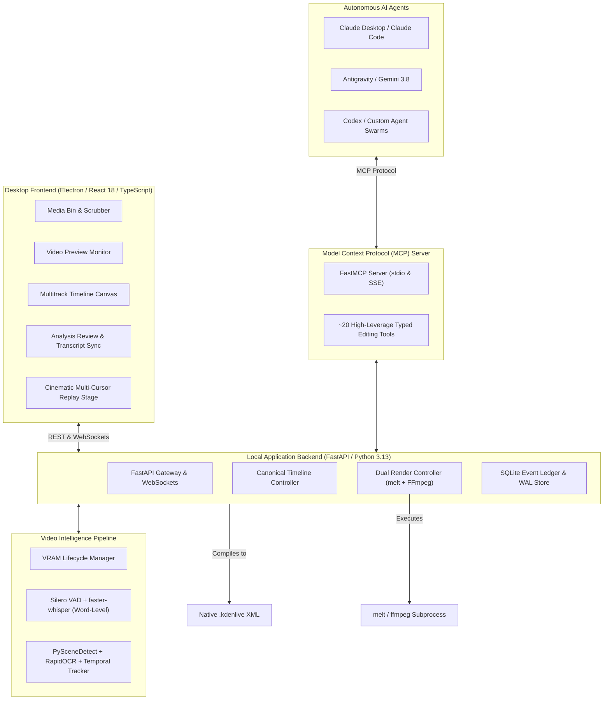

<div align="center">

# 🎬 AgentCut

### AI-Native Multi-Agent Video Editing Studio

[](https://github.com/hatimbenayad/AgentCut/actions/workflows/ci.yml)
[](LICENSE)
[](https://www.python.org/)
[](https://modelcontextprotocol.io/)
[](https://kdenlive.org/)
[](https://www.electronjs.org/)

**AgentCut** is an AI-native video production environment where autonomous AI agents genuinely understand raw footage, execute non-linear editing decisions through the Model Context Protocol (MCP), render finished deliverables, and visualize their collaborative editing process through an animated multi-cursor replay.

[Product Vision](docs/product/product-vision.md) • [System Architecture](docs/architecture/system-architecture.md) • [Architecture Decisions (ADRs)](docs/architecture/architecture-decisions.md) • [Roadmap](docs/product/roadmap.md)

</div>

---

## 🌟 Key Differentiators

This is **not** a conventional video editor with an AI chatbot attached. It is built around genuine editing capabilities:

1. **Pre-Cognitive Video Intelligence Engine:**
   The AI understands the footage before making editing decisions. It performs voice activity detection (Silero VAD), word-level transcription (`faster-whisper`), acoustic pause taxonomy (conversational vs. dramatic vs. dead air), speech disfluency analysis, shot cut detection (`PySceneDetect`), and temporal on-screen text tracking (`RapidOCR` PP-OCRv4).
2. **Canonical Typed Timeline Core:**
   A versioned, typed timeline model in SQLite/JSON serves as the single source of truth, offering transactional rollbacks, fine-grained interval locking, and zero XML corruption risk.
3. **Dual-Engine Rendering (Kdenlive / MLT + FFmpeg):**
   - **MLT `melt`:** Direct headless compilation of native `.kdenlive` project files.
   - **Native FFmpeg Fallback:** Direct compilation to high-speed FFmpeg `-filter_complex` filtergraphs, guaranteeing immediate out-of-the-box rendering on any machine without external dependencies.
4. **Universal Model Context Protocol (MCP) Interface:**
   Exposes ~20 high-leverage, strongly typed tools over `stdio` and `SSE` transports. Any MCP-compatible agent (Claude Desktop, Codex, Antigravity, custom agent loops) can inspect intelligence, assemble multitrack projects, and trigger exports.
5. **Signature Cinematic Multi-Agent Collaborative Replay:**
   Visualizes the collaborative editing process. The application records genuine editing operations to an immutable SQLite event ledger and reconstructs them visually at 60 FPS using Framer Motion with distinct color-coded cursors (Cyan for Video Editor, Purple for Audio, Yellow for Captions, Green for Colorist, Red for QC).

---

## 🏛️ System Architecture



---

## 🚀 Quickstart

### Prerequisites
- Python 3.11+ (Tested on Python 3.13 on Windows 11)
- Node.js 20+
- FFmpeg 5.0+ installed and on system `PATH` (Tested with FFmpeg 8.0)

### 1. Clone & Set Up Python Environment
```bash
git clone https://github.com/hatimbenayad/AgentCut.git
cd AgentCut

# Create virtual environment
python -m venv .venv

# Activate on Windows:
.\.venv\Scripts\Activate.ps1
# Activate on Linux/macOS:
source .venv/bin/activate

# Install dependencies (pinned for stability)
pip install -r requirements.txt
```

### 2. Run the S2 Empirical Timeline Compilation Test
```bash
python experiments/timeline_mlt/test_timeline_compile.py
```
*Output: Compiles canonical model to native `.kdenlive` XML and renders a verified 6.00s MP4 with a 1.15x punch-in jump cut and subtitle overlay in ~0.58s!*

### 3. Run the S6 Model Compatibility Benchmark
```bash
python experiments/test_model_compatibility.py
```
*Output: Verifies RapidOCR (606ms), PySceneDetect (0.60s), and faster-whisper (0.48s) on target hardware.*

---

## 📋 Comprehensive Specifications

| Subsystem | Specification Document | Key Capabilities |
| :--- | :--- | :--- |
| **Product Vision** | [`docs/product/product-vision.md`](docs/product/product-vision.md) | Problem analysis, 4 pillars, flagship user scenario |
| **System Architecture** | [`docs/architecture/system-architecture.md`](docs/architecture/system-architecture.md) | Subsystems, ER schema, VRAM lifecycle management |
| **Architecture Decisions** | [`docs/architecture/architecture-decisions.md`](docs/architecture/architecture-decisions.md) | ADR-001 through ADR-013 with empirical backing |
| **Video Intelligence** | [`docs/specs/video-intelligence/spec.md`](docs/specs/video-intelligence/spec.md) | VAD, STT, pause classification, temporal OCR tracking |
| **Canonical Timeline** | [`docs/specs/timeline-editor/spec.md`](docs/specs/timeline-editor/spec.md) | Abstract timeline, MLT serialization, punch-in cuts |
| **Dual-Engine Render** | [`docs/specs/rendering/spec.md`](docs/specs/rendering/spec.md) | Headless `melt` + native FFmpeg filtergraphs |
| **MCP Server** | [`docs/specs/mcp-server/spec.md`](docs/specs/mcp-server/spec.md) | FastMCP tools, typed Pydantic contracts, stdio & SSE |
| **Multi-Agent Orchestration** | [`docs/specs/agent-orchestration/spec.md`](docs/specs/agent-orchestration/spec.md) | 7 specialized agent roles, interval locks, transactions |
| **Cinematic Replay** | [`docs/specs/activity-replay/spec.md`](docs/specs/activity-replay/spec.md) | 60 FPS Framer Motion multi-cursor visual reconstruction |
| **Replay Event Schema** | [`docs/specs/activity-replay/event-schema.md`](docs/specs/activity-replay/event-schema.md) | Relational SQLite ledger & visual staging contracts |

---

## 🗺️ Progressive Roadmap

- [x] **Milestone 1:** Inception, Research, Architecture, and Empirical Specifications
- [ ] **Milestone 2:** End-to-End Vertical Slice (Ingest → Intelligence → Timeline → Render → Ledger → Replay)
- [ ] **Milestone 3:** Deepened Intelligence & Proxy Previews
- [ ] **Milestone 4:** Production FastMCP Server (~20 Coarse Tools)
- [ ] **Milestone 5:** Multi-Agent Orchestration & Concurrency Layer
- [ ] **Milestone 6:** Desktop Studio Application (Electron + React 18)
- [ ] **Milestone 7:** Cinematic Multi-Agent Collaborative Replay Studio
- [ ] **Milestone 8:** End-to-End Integration, Stress Testing & Windows Packaging

See [`docs/product/roadmap.md`](docs/product/roadmap.md) for detailed deliverables and exit criteria.

---

## 🤝 Contributing

We follow **AI-DLC (AI-Driven Development Lifecycle)** and **SDD (Spec-Driven Development)**:
- Every feature must be specification-first.
- Architecture decisions are recorded in ADRs.
- Original footage remains immutable.
- Replays must reflect real logged operations.

See [`CONTRIBUTING.md`](CONTRIBUTING.md) for workflow details.

---

## 📄 License

Distributed under the **MIT License**. See [`LICENSE`](LICENSE) for details.
