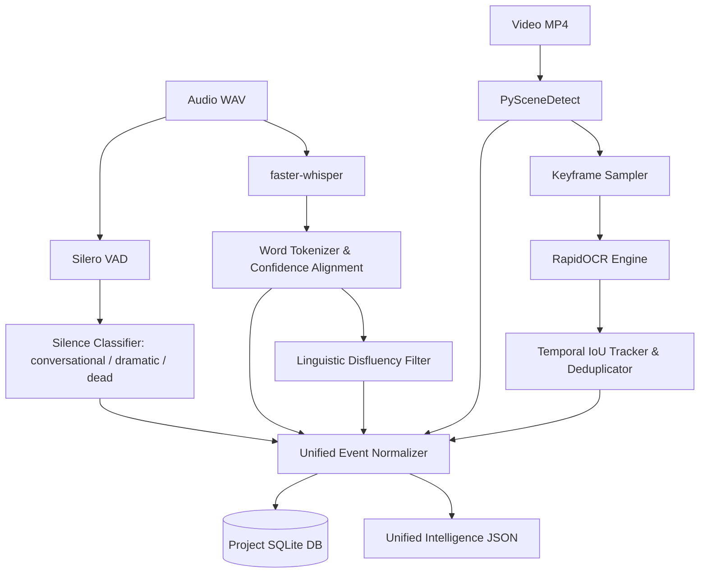

# AgentCut: Data Flow & Event Sequences

## 1. End-to-End Pipeline Data Flow

The following sequence diagram details the full data flow from raw footage import through intelligence analysis, MCP agent editing, and final rendering:

```mermaid
sequenceDiagram
    autonumber
    actor User as Human Creator
    participant UI as Electron UI
    participant API as FastAPI Backend
    participant Intel as Intelligence Engine
    participant DB as SQLite Project DB
    participant MCP as MCP Server
    actor Agent as Autonomous AI Agent
    participant Timeline as Timeline / MLT Engine
    participant Render as Render Controller

    Note over User, UI: 1. INGESTION & INTELLIGENCE
    User->>UI: Drag and drop raw video (e.g. raw_footage.mp4)
    UI->>API: POST /api/projects/{id}/media/import
    API->>API: FFprobe metadata extraction & create proxy cache
    API->>Intel: Trigger Sequential Pipeline (Audio -> Visual)
    
    Intel->>Intel: Stage 1: Silero VAD + faster-whisper (Word Timestamps)
    Intel->>Intel: Stage 2: PySceneDetect + Adaptive Keyframe Sampler
    Intel->>Intel: Stage 3: RapidOCR + IoU Temporal Box Tracker
    Intel-->>API: Normalized Intelligence Graph
    API->>DB: Store transcripts, silences, scenes, OCR events
    API-->>UI: WebSocket push: Analysis Complete
    UI->>User: Display Waveform, Clickable Transcript & Scene Thumbnails

    Note over User, Agent: 2. AGENT COLLABORATION & EDITING VIA MCP
    User->>Agent: Prompt: "Create 45s TikTok, dynamic cuts, yellow captions"
    Agent->>MCP: get_video_analysis(project_id)
    MCP->>DB: Query speech, silences, scenes
    MCP-->>Agent: Structured intelligence JSON
    
    Agent->>Agent: Director plans pacing; Analyst selects timestamps
    Agent->>MCP: add_video_clip(track="V1", source_in=4.2, source_out=18.5)
    MCP->>Timeline: Mutate timeline state
    Timeline->>DB: Log event (evt_101, Video Editor, cyan, add_clip)
    Timeline-->>MCP: Success (clip_id_1)
    
    Agent->>MCP: split_clip(clip_id_1, split_at=12.0)
    Timeline->>DB: Log event (evt_102, Video Editor, split_clip)
    
    Agent->>MCP: generate_captions(style={"highlight_color": "#FFDE00"})
    Timeline->>DB: Log event (evt_103, Caption Designer, yellow, generate_captions)
    
    Timeline->>API: Broadcast state change via WebSocket
    API-->>UI: Live update timeline tracks & clips

    Note over User, Render: 3. RENDERING & EXPORT
    Agent->>MCP: render_video(preset="tiktok_9_16_1080p")
    MCP->>Render: Dispatch render job
    Render->>Render: Compile timeline to MLT XML / FFmpeg filtergraph
    Render->>Render: Execute melt / ffmpeg CLI with NVENC
    Render-->>API: Stream percentage progress (25%, 50%, 100%)
    API-->>UI: Update render progress bar
    Render->>Render: Verify output MP4 integrity
    Render-->>Agent: Output ready: export_final.mp4

    Note over User, UI: 4. CINEMATIC MULTI-CURSOR REPLAY
    User->>UI: Click "Cinematic Replay"
    UI->>API: GET /api/projects/{id}/events
    API->>DB: Query immutable event ledger
    DB-->>UI: Chronological event stream [evt_101, evt_102, evt_103]
    UI->>UI: Framer Motion animates multi-agent cursors & timeline builds
```

---

## 2. Intelligence Event Normalization Data Flow

Raw outputs from disparate AI models are normalized into a unified, timestamp-indexed schema before persistence:



---

## 3. Replay Event Transformation Pipeline

The Cinematic Replay engine does not poll or record screen pixels. Instead, it transforms semantic editing operations into spatial-temporal visual primitives:

1. **Raw Event in SQLite**:
   ```json
   {
     "event_id": "evt_402",
     "agent_id": "video_editor",
     "agent_name": "Video Editor",
     "agent_color": "#00D9FF",
     "action": "move_clip",
     "source_clip": "interview_01.mp4",
     "source_in": 14.2,
     "source_out": 22.8,
     "target_track": 1,
     "timeline_position": 8.0,
     "timestamp": 1710000045
   }
   ```
2. **Visual Primitive Compiler**:
   - Calculates screen coordinates for Media Bin thumbnail: `(x_start: 140, y_start: 320)`.
   - Calculates target track and timeline drop coordinates: `(x_end: 480, y_end: 650)`.
   - Generates motion path: Bezier curve from `(140, 320)` to `(480, 650)` over 600ms.
   - Attaches cursor style: Cyan cursor with label `"Video Editor"`.
   - Generates timeline reaction: Clip ghost appears on track 1, snaps to position, and waveform renders.
3. **Framer Motion Engine**:
   - Interpolates cursor position, click ripple, clip drag, and placement with 60 FPS hardware acceleration.

