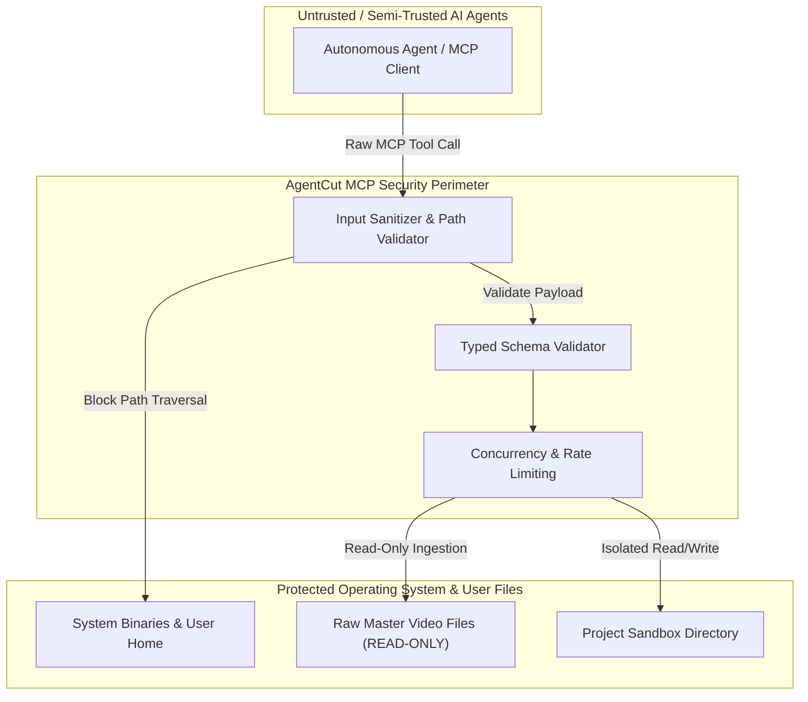

# AgentCut: Security, Isolation & Reliability Architecture

## 1. Threat Modeling & Security Boundaries

Because AgentCut accepts instructions and commands from external AI agents (via MCP or local LLMs), security boundaries must be strictly enforced. External agents cannot be granted unconstrained OS access.

---

## 2. Core Security Controls

### 2.1 Path Traversal & Filesystem Jail
- **Restricted Base Path**: AI agents can only reference assets inside:
  - The designated project directory (e.g., `<project_root>/media/`).
  - Explicitly user-imported media files.
- **Strict Canonicalization**: All path arguments passed to `import_media`, `add_video_clip`, etc., are resolved using `os.path.realpath()` and verified against an allowed directory whitelist. Any path containing `..`, absolute system paths (e.g., `C:\Windows\System32`), or unauthorized drives is immediately rejected with a typed validation error.

### 2.2 Immutable Raw Master Footage
- **Read-Only Ingestion**: Once imported into AgentCut, source media files are accessed with read-only file permissions (`O_RDONLY` in Python / non-destructive file handles in FFmpeg).
- **Prohibition of In-Place Overwrites**: Neither the UI, the MCP server, nor internal rendering processes can overwrite or truncate a source media file. All edits produce virtual timeline clips or output to distinct export filenames.

### 2.3 Command Injection Prevention
- **No Arbitrary Shell Execution**: AgentCut never calls `os.system()` or passes raw strings to `shell=True` subprocesses.
- **Parametrized Subprocesses**: All invocations of FFmpeg, FFprobe, and MLT `melt` use strict argument lists (e.g., `["ffmpeg", "-ss", str(start), "-i", sanitized_path, ...]`), preventing shell injection attacks.

### 2.4 Project Locking & Concurrency Control
- **Optimistic Interval Locking**: Multiple agents operating concurrently must acquire a lock on the target track and timeline interval before executing modifications.
- **Atomic Rollback on Error**: If an agent requests a sequence of 5 cuts and the 4th fails validation (e.g. invalid time bounds), the entire transaction rolls back to the previous snapshot, preserving timeline integrity.

### 2.5 Output Verification & Anti-Corruption Gate
- **Render Validation**: Before a render operation is reported as successful, AgentCut runs an automatic verification check:
  - Checks file size (> 100 KB).
  - Inspects container headers via FFprobe.
  - Compares target timeline duration with rendered stream duration (tolerance ±0.2s).
  - Ensures video and audio streams are both present and synchronized.

