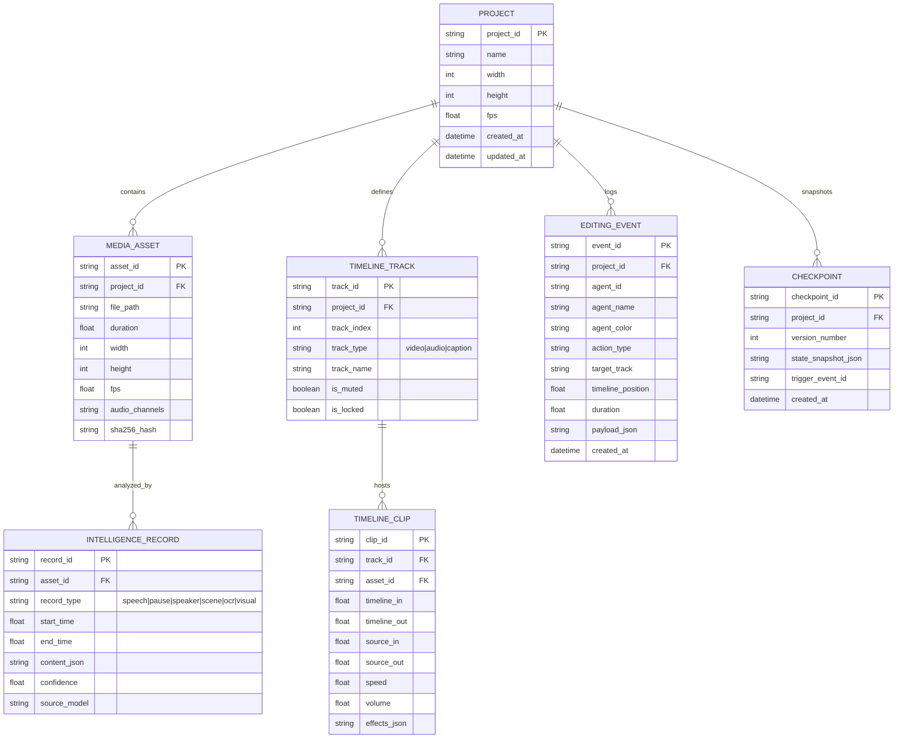

# AgentCut: System Architecture Document

## 1. High-Level Architecture Overview

AgentCut adopts a decoupled, local-first client-service architecture designed for high-performance multimedia handling, deterministic timeline manipulation, and autonomous agent interoperability.

```mermaid
graph TB
    subgraph ClientLayer["Desktop Frontend (Electron / React 18 / TypeScript)"]
        UI_MediaBin["Media Bin Panel"]
        UI_Player["Video Preview Player"]
        UI_Timeline["Multitrack Timeline Canvas/DOM"]
        UI_Review["Analysis Review & Transcript Editor"]
        UI_Agents["Agent Activity & Orchestration Panel"]
        UI_Replay["Cinematic Multi-Cursor Replay Studio"]
        State_Zustand["Zustand Global State & IPC Bridge"]
    end

    subgraph ServiceLayer["Local Application Services (FastAPI / Python 3.13)"]
        API_Gateway["FastAPI Gateway & WebSocket / SSE Manager"]
        Service_Media["Media Ingestion & FFmpeg Proxy Service"]
        Service_Timeline["Timeline & MLT XML Engine"]
        Service_Render["Dual Render Controller (MLT melt / FFmpeg)"]
        Service_Events["Event Ledger & Checkpoint Manager"]
        Store_SQLite[("SQLite Project DB & WAL Ledger")]
    end

    subgraph IntelligenceLayer["Video Intelligence Engine"]
        VAD_Silero["Silero VAD (Audio Segmentation)"]
        STT_Whisper["faster-whisper (CTranslate2 Alignment)"]
        Diar_Pyannote["Speaker Diarization"]
        Linguistic["Disfluency & Filler Word Classifier"]
        Scene_Detect["PySceneDetect (Cut & Transition Detector)"]
        Keyframe_Sampler["Adaptive Keyframe Sampler (Motion & Cuts)"]
        OCR_Rapid["RapidOCR (PP-OCRv4 ONNX with IoU Tracker)"]
        Vision_LLM["Visual Semantic Captioner (Qwen2.5-VL Quantized / API)"]
        VRAM_Manager["VRAM Lifecycle & Model Staging Manager"]
    end

    subgraph MCPLayer["Model Context Protocol (MCP) Interface"]
        MCP_Server["FastMCP Server (stdio & SSE)"]
        MCP_Tools_Proj["Project & Asset Tools"]
        MCP_Tools_Intel["Intelligence Inspection Tools"]
        MCP_Tools_Edit["Timeline & Clip Manipulation Tools"]
        MCP_Tools_Rnd["Render & Export Tools"]
        MCP_Tools_Collab["Agent Collaboration & Lock Tools"]
    end

    subgraph ExternalAgents["External AI Agents (MCP Clients)"]
        Agent_Claude["Claude Desktop / Claude Code"]
        Agent_Antigravity["Antigravity / Gemini 3.8"]
        Agent_Codex["Codex / Custom Autonomous Loops"]
    end

    %% Connections
    ClientLayer <-->|HTTP REST & WebSockets| ServiceLayer
    ExternalAgents <-->|MCP Protocol (stdio / SSE)| MCPLayer
    MCPLayer <--> ServiceLayer
    ServiceLayer <--> IntelligenceLayer
    ServiceLayer <--> Store_SQLite
    Service_Timeline -->|Generates .kdenlive| Kdenlive_Desktop["Native Kdenlive Desktop App (Optional)"]
    Service_Render -->|CLI Invocation| Melt_FFmpeg["melt / ffmpeg CLI"]
```

---

## 2. Subsystem Decomposition

### 2.1 Desktop Client (Frontend)
- **Framework**: Electron 34+ with React 18, TypeScript, Tailwind CSS, Zustand, and Framer Motion.
- **Role**: High-performance UI rendering, timeline interaction, synchronized audio/video playback, and real-time visualization of agent activity.
- **Key Modules**:
  - `MediaBin`: Displays ingested assets, metadata chips, waveform ribbons, and hover-scrub previews.
  - `VideoPlayer`: Custom HTML5 Video player synchronized to timeline frames with sub-millisecond precision, timecode display, and playback speed controls.
  - `TimelineEditor`: Virtualized multi-track timeline rendering video tracks, audio tracks with mini-waveforms, transitions, and subtitle clips.
  - `AnalysisReview`: Synchronized text-and-waveform editor allowing creators to inspect and correct AI transcription, silence tags, and speaker names.
  - `AgentActivityPanel`: Real-time streaming log of agent reasoning, planned tasks, active locks, and historical operations.
  - `CinematicReplayCanvas`: GPU-accelerated 60 FPS animation canvas rendering multi-agent cursors, dragging animations, and live timeline transformations.

### 2.2 Local Application Backend (Python 3.13 / FastAPI)
- **Framework**: FastAPI with Uvicorn, Pydantic v2, and SQLite with WAL mode.
- **Role**: Central coordinator for media processing, project serialization, concurrency management, and REST/WebSocket communication with the Electron UI.
- **Key Modules**:
  - `ProjectManager`: Handles project creation, saving, auto-backup (`.bak`), and project settings (resolution, framerate, aspect ratio).
  - `TimelineController`: Manages the abstract timeline state in memory with atomic transactional mutations and undo/redo history.
  - `MLTSerializer`: Compiles the in-memory timeline into a standard Kdenlive XML (`.kdenlive`) file and parses existing projects.
  - `RenderController`: Spawns and manages rendering worker processes (MLT `melt` or direct FFmpeg filtergraph), parsing progress percentages and handling graceful cancellations.
  - `EventLedger`: SQLite-backed append-only transaction ledger storing every agent operation for the replay engine.

### 2.3 Video Intelligence Engine
- **Role**: Extracts comprehensive audio, linguistic, visual, and semantic information from raw footage without blowing past the 6GB VRAM budget.
- **Key Modules**:
  - `VRAMLifecycleManager`: Enforces strict sequential model execution. Loads one heavy model at a time into VRAM, executes batch inference, flushes PyTorch CUDA caches, and releases memory before the next stage.
  - `AudioIntelligencePipeline`:
    - `Silero VAD`: Extracts speech intervals and segments audio into pause classifications.
    - `faster-whisper`: Employs CTranslate2 FP16/INT8 for ultra-fast, accurate transcription with word-level start/end timestamps.
    - `LinguisticAnalyzer`: Analyzes transcript tokens for filler words, repeated phrases, and false starts.
    - `SpeakerDiarizer`: Assigns recording-specific speaker IDs.
  - `VisualIntelligencePipeline`:
    - `PySceneDetect`: Detects shot transitions and hard cuts using adaptive thresholding.
    - `AdaptiveKeyframeSampler`: Selects informative keyframes at shot heads/tails and motion peaks.
    - `RapidOCR`: Detects on-screen titles, lower-thirds, and graphics.
    - `TemporalBoxTracker`: Tracks OCR boxes across time using IoU and text edit distance, unifying multi-frame sightings into consolidated time spans.

### 2.4 Model Context Protocol (MCP) Server
- **Framework**: Official Python `mcp` SDK.
- **Role**: Provides standard, typed tool interfaces so any MCP-compliant AI agent (Claude, Codex, Antigravity, etc.) can inspect video intelligence, assemble the timeline, apply effects, and render outputs.
- **Transport Modes**:
  - `stdio`: Ideal for local CLI agents and Claude Desktop running AgentCut as a local subprocess.
  - `SSE (Server-Sent Events)`: Ideal for web-based or networked agent platforms connecting over HTTP.

### 2.5 Multi-Agent Orchestration & Concurrency Layer
- **Role**: Coordinates multiple specialized agents working on a single project.
- **Components**:
  - `RoleRegistry`: Predefined agent profiles (Director, Analyst, Editor, Audio Engineer, Caption Designer, Colorist, Quality Controller) with specialized permissions and tool scopes.
  - `IntervalLockManager`: Optimistic interval locking preventing two agents from conflicting on the same timeline track and time range simultaneously.
  - `AtomicTransactionCoordinator`: Executes multi-step editing tool sequences inside atomic transactions. If any step fails, the project state automatically reverts to the pre-transaction checkpoint.

---

## 3. Storage & State Persistence Architecture



---

## 4. Hardware Optimization & VRAM Staging Strategy

Given the target hardware (AMD Ryzen 7 7435HS, 24GB RAM, NVIDIA RTX 4050 Laptop GPU with 6GB VRAM):

| Pipeline Stage | Active Model | Execution Device | Peak VRAM | Duration / Ratio | Strategy |
| :--- | :--- | :--- | :--- | :--- | :--- |
| **0. Audio Extraction** | FFmpeg CLI | CPU | 0 MB | ~0.05x Realtime | Subprocess stream |
| **1. Voice Activity** | Silero VAD | ONNX / CPU | < 50 MB | ~0.02x Realtime | Ultra-lightweight |
| **2. Transcription** | faster-whisper | CUDA (CTranslate2) | ~1.5 GB | ~0.10x Realtime | FP16 compute, freed after run |
| **3. Diarization** | Pyannote Audio | CUDA / PyTorch | ~1.6 GB | ~0.15x Realtime | Loaded after Whisper unloads |
| **4. Scene Detection** | PySceneDetect | CPU (Multi-core) | 0 MB | ~0.08x Realtime | OpenCV CPU multithreading |
| **5. Keyframe Extraction**| OpenCV | CPU / RAM | 0 MB | ~0.02x Realtime | Selective frame decodes |
| **6. On-Screen OCR** | RapidOCR | ONNX Runtime | ~400 MB | ~0.12x Realtime | Batched keyframe inference |
| **7. Visual Semantics** | Qwen2.5-VL-3B | CUDA (4-bit AWQ) | ~2.4 GB | On-Demand | Lazy-loaded on sampled keyframes |
| **8. Video Rendering** | MLT `melt` / FFmpeg | CPU + NVENC | ~800 MB | Realtime | Hardware NVENC acceleration |

**Invariant**: Peak VRAM never exceeds 3.5 GB out of the 4.8 GB available free VRAM, eliminating CUDA Out-Of-Memory (OOM) risks.

