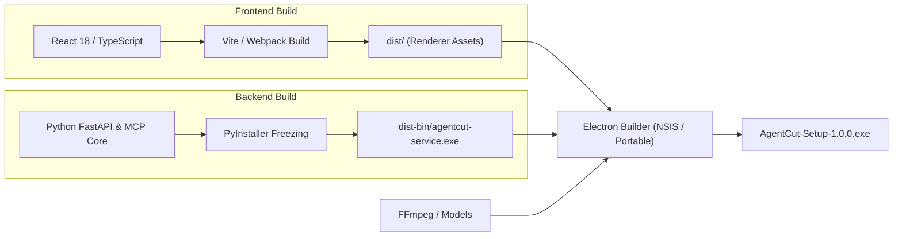

# Operations: Deployment, Packaging & Distribution

## 1. Packaging Architecture for Windows

AgentCut distributes as a standalone, zero-friction desktop application for Windows:
- **Electron Builder**: Packages the frontend UI, Chromium runtime, and Electron main process into an NSIS installer and portable executable (`.exe`).
- **Python Backend Sidecar**: Uses PyInstaller or bundled virtual environment to freeze the FastAPI backend, Uvicorn, and Python MCP server into an isolated local sidecar binary (`agentcut-service.exe`).
- **Bundled Binaries**:
  - `ffmpeg.exe` and `ffprobe.exe` bundled in `resources/bin/`.
  - ONNX runtime DLLs and CTranslate2 runtime libraries bundled alongside the Python sidecar.

---

## 2. Build Pipeline

---

## 3. Production Release Checklist

1. **VRAM Safety Verification**: Assert peak memory under load does not exceed 4.2 GB.
2. **Offline Air-Gap Testing**: Disconnect network; verify that VAD, transcription, editing, rendering, and replay execute with 100% functionality.
3. **Kdenlive Compatibility Check**: Open 5 rendered projects in native Kdenlive 23.x/24.x desktop; ensure all tracks, cuts, and transitions load without missing asset errors.
4. **Code Signing**: Sign executable and NSIS installer with standard Authenticode certificate.

