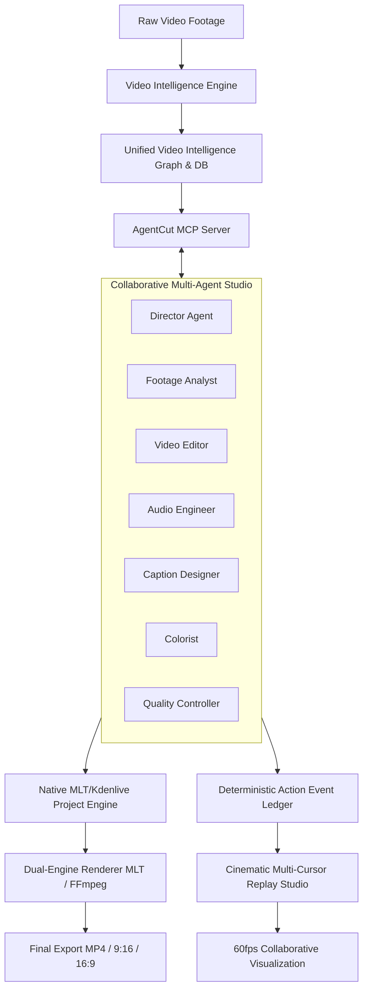

# AgentCut: Product Vision & Strategic Charter

## 1. Executive Summary

**AgentCut** is an AI-native, multi-agent desktop video production studio. Unlike conventional non-linear video editors (NLEs) that attach a superficial AI chat assistant as an afterthought, AgentCut is architected from the ground up as a collaborative production environment where autonomous AI agents genuinely understand raw multimedia content, execute deterministic non-linear editing decisions through standard protocols (Model Context Protocol - MCP), render broadcast-ready videos, and expose their collaborative thought processes through an animated, cinematic multi-cursor replay.

AgentCut bridges the gap between raw human creative intent and complex video engineering by decoupling **creative direction** (provided via natural language by the human creator or Director Agent) from **computational execution** (performed deterministically by specialized autonomous subagents manipulating a native MLT/Kdenlive timeline).

---

## 2. The Core Problem

Traditional video editing suffers from severe productivity bottlenecks:
1. **High Cognitive Load on Rough Cuts**: Content creators spend 70-80% of editing time on mechanical tasks: scrubbing hours of footage, removing dead air, cutting out stutters and false starts, transcribing dialogue, identifying B-roll points, and synchronizing subtitle text.
2. **"Black Box" Generative Video Tools**: Modern generative AI tools (text-to-video) offer zero surgical control over existing real-world footage. Once generated, a video cannot be non-linearly adjusted or retimed without regenerating from scratch.
3. **Fragile AI Plugins**: Existing NLE plugins use brittle UI scripting or macros that fail when UI elements move, have no spatial/semantic understanding of footage, and cannot explain *why* an edit was made.
4. **Lack of Transparency & Trust**: When AI touches a project, creators want to know: *What clips were cut? Why was this pause preserved? What did the audio agent change?*

---

## 3. The AgentCut Solution

AgentCut resolves these challenges through four foundational pillars:

### Pillar I: Deep Video Intelligence (Pre-Cognition)
The AI never cuts blindly. Before any editing tool is invoked, the **Video Intelligence Engine** parses audio, speech, pauses, acoustics, speaker identities, scenes, keyframes, and on-screen text into a unified, frame-accurate temporal database. The agents reason with full context about speech dynamics, dramatic silences, topic transitions, and visual composition.

### Pillar II: Native, Non-Destructive Editing Core (Kdenlive & MLT)
AgentCut uses the battle-tested **MLT Multimedia Framework** and the **Kdenlive XML project format** (`.kdenlive`). The edits are non-destructive: original source footage remains immutable. Every cut, trim, transition, speed alteration, and color grade is written to a human-readable, open project file that can be opened and refined in native desktop Kdenlive at any time.

### Pillar III: Universal MCP Control Interface
AgentCut exposes every editing, intelligence, and project management function as a typed Model Context Protocol (MCP) tool. External agents running in Claude, Codex, Gemini, Antigravity, or custom autonomous agent loops can inspect footage, execute multi-track edits, and trigger renders through a standardized protocol.

### Pillar IV: Cinematic Multi-Agent Collaborative Replay
AgentCut records every agent operation into an immutable, time-stamped event ledger. In the **Cinematic Replay Mode**, the user watches an animated, 60 FPS reconstruction of the edit where distinct, color-coded agent cursors (Cyan for Video Editor, Purple for Audio Engineer, Yellow for Caption Designer, Green for Colorist, Red for QC) simultaneously scrub footage, drag clips from the media bin, slice dead air, snap captions to speech peaks, and balance audio. The replay is deterministic, scrubbable, and repeatable.

---

## 4. Target User Persona & Flagship User Journey

### Primary Persona: Content Creators & Digital Producers
- **Profile**: YouTube creators, TikTok/Reels producers, educators, interview podcasters, and agency video editors.
- **Goal**: Produce engaging, tightly paced videos (e.g., 9:16 vertical shorts, structured tutorials, interview highlights) in minutes instead of hours.

### Flagship User Scenario
1. **Footage Ingestion**: The user drags a 15-minute raw camera recording of a multi-topic monologue or podcast into AgentCut's Media Bin.
2. **Automated Intelligence Extraction**: AgentCut extracts audio, runs Silero VAD to detect pauses, transcribes speech with word-level timestamps via `faster-whisper`, isolates scenes via `PySceneDetect`, and tracks on-screen text with `RapidOCR`.
3. **Interactive Human Verification**: The user views the synchronized waveform and interactive transcript in the Analysis Review panel, adjusting any technical jargon.
4. **Natural Language Directing**: The user submits an instruction:
   > *"Create a 45-second high-energy TikTok from my footage. Find the strongest hook, eliminate dead air while preserving natural dramatic pauses, add dynamic jump cuts with slight punch-ins, generate modern yellow-highlighted captions, apply a vibrant warm grade, and export in 9:16."*
5. **Agent Orchestration**:
   - **Director Agent** identifies the viral thesis statement at 04:12 as the hook and maps the narrative arc.
   - **Footage Analyst** pulls exact millisecond timestamps of filler words ("um", "you know") and awkward silences (> 1.2s).
   - **Video Editor** adds clips to Video Track 1, performs jump cuts, and applies alternating 1.1x punch-ins.
   - **Caption Designer** stamps synchronized word-by-word animated captions onto the subtitle track.
   - **Colorist** injects a warm saturation curve.
   - **Quality Controller** verifies audio levels (-14 LUFS) and absence of black frames.
6. **Instant Export & Native Project**: AgentCut renders an MP4 ready for distribution, accompanied by the fully editable `.kdenlive` project file.
7. **Cinematic Replay**: The creator clicks **Cinematic Replay** and watches their AI team execute the timeline assembly with smooth cursor paths and synchronized timeline manipulations.

---

## 5. Non-Negotiable Engineering Principles

1. **Original Footage is Immutable**: Raw media is read-only. Edits only exist as timeline metadata references.
2. **Context-Aware Pacing**: Pauses are not all equal. Conversational pauses (< 0.5s) and dramatic beats are preserved; only unnatural dead air and hesitation stumbles are cut.
3. **Traceability (Source-to-Timeline Mapping)**: Every cut clip on the timeline maintains a cryptographic link back to its original file and millisecond in/out range.
4. **Deterministic Visual Replay**: Visual replay is never a randomized cosmetic animation; it faithfully reflects the actual operational history logged during the editing session.
5. **Zero Vendor Lock-in**: Projects are saved in open MLT/Kdenlive XML; renders can run on MLT `melt` or FFmpeg.

