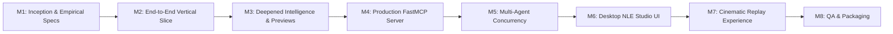

# AgentCut: Revised Progressive Roadmap (Vertical-Slice First)

Following the Lead Architectural Advisory (**Suggestion S4**), the roadmap is structured around an early **End-to-End Vertical Slice** (Milestone 2) to prove and test the entire production loop before expanding into secondary features.

---

## Milestone Breakdown

### Milestone 1: Research, Inception & Empirical Specifications (COMPLETED)
- **Status**: `Verified`
- **Accomplishments**:
  - Full host audit: Windows 11, Ryzen 7 7435HS, NVIDIA RTX 4050 6GB VRAM, Python 3.13, FFmpeg 8.0.
  - Empirical Timeline Experiment: Canonical Typed Timeline Model successfully compiled to `.kdenlive` XML and rendered directly via FFmpeg in 0.58s with exact 6.00s duration, trimmed clips, punch-in jump cuts, and subtitles.
  - Empirical Model Test: RapidOCR (606ms), PySceneDetect (0.60s), and `faster-whisper` (0.48s with `av<14` on CPU/CUDA) verified working.
  - Complete documentation package (19 files across `/docs`).
  - Draft Replay Event Schema designed.

---

### Milestone 2: End-to-End Vertical Slice (NEXT IMMEDIATE TARGET)
- **Goal**: Build and run an end-to-end working vertical slice from raw footage to rendered video and animated replay.
- **Scope**:
  1. **Ingest & Extract**: Audio extraction via FFmpeg from a real video.
  2. **Analyze**: Silero VAD pause detection + `faster-whisper` transcription + `PySceneDetect` scene cuts.
  3. **Export Schema**: Write normalized Unified Intelligence JSON.
  4. **Assemble Timeline**: Construct canonical timeline model, remove dead air, apply 1.15x punch-in jump cut, and add stylized caption.
  5. **Render Video**: Execute direct render to 1080p MP4 and compile `.kdenlive` project.
  6. **Record Events**: Atomically log operations to SQLite `editing_events`.
  7. **Replay Prototype**: Reconstruct and animate multi-cursor collaborative replay from recorded events.
- **Exit Criteria**: A real video file is imported, analyzed, programmatically edited, rendered, and replayed with animated cursors.

---

### Milestone 3: Deepened Intelligence & Proxy Preview Engine
- **Scope**:
  - Full acoustic pause classifier (conversational vs dramatic vs dead air).
  - RapidOCR with temporal IoU box tracking.
  - Speaker diarization module with HuggingFace token and VAD fallback.
  - Low-resolution proxy generator for responsive UI scrubbing.
  - Long video chunking manager.

---

### Milestone 4: Production FastMCP Server (~20 Coarse Tools)
- **Scope**:
  - Coarse, high-leverage tool surface (S5).
  - Stdio transport for Claude Desktop / CLI and SSE transport for networked agents.
  - Automated MCP client test harness.

---

### Milestone 5: Multi-Agent Orchestration & Concurrency Layer
- **Scope**:
  - 7 specialized agent roles (Director, Analyst, Editor, Audio, Captions, Colorist, QC).
  - Track-interval optimistic locking.
  - Multi-agent coordination on shared SQLite project state.

---

### Milestone 6: Desktop Studio Application (Electron + React 18)
- **Scope**:
  - Dark-themed post-production UI (Media Bin, Video Player, Multitrack Timeline Canvas, Review Editor).
  - Click-to-seek transcript editor with waveform pause overlays.
  - Live WebSocket telemetry bridge.

---

### Milestone 7: Cinematic Multi-Agent Collaborative Replay Studio
- **Scope**:
  - Framer Motion 60 FPS animation stage.
  - 5 distinct agent cursors (Cyan, Purple, Yellow, Green, Red) with tool icons and haptic particle visuals.
  - Scrubber, speed multipliers (0.5x, 1x, 2x, 4x), full-screen, and instant **Restart Replay** button.

---

### Milestone 8: End-to-End QA, Stress Testing & Windows Packaging
- **Scope**:
  - 15-step Definition of Done validation.
  - 30-minute 4K footage stress testing.
  - Electron Builder NSIS installer and standalone sidecar binary.
