# Specification: Cinematic Multi-Agent Collaborative Replay Studio

## 1. Feature Mission & Core Value

The **Cinematic Multi-Agent Editing Replay** is AgentCut's signature capability. It allows creators, clients, and collaborators to watch a visually stunning, animated reconstruction of how specialized autonomous AI agents reasoned, coordinated, and assembled the final video project.

> **CRITICAL ARCHITECTURAL DISTINCTION**:
> The animation is **not** how the actual editing occurs. The AI agents edit programmatically via high-speed MCP tools in milliseconds. AgentCut records the real, immutable operations in an atomic event ledger, and the Replay Studio reconstructs the entire process visually afterward.

---

## 2. Visual Experience & Cursor Choreography

Inspired by high-end collaborative creative tools, the Replay Studio visualizes the editing environment as a bustling digital studio:

```mermaid
graph LR
    subgraph EventStream["Authoritative Event Ledger (SQLite)"]
        E1["evt_001: Video Editor moves Clip 1 to V1"]
        E2["evt_002: Audio Engineer balances Audio on A1"]
        E3["evt_003: Video Editor splits Clip 1 at 12.4s"]
        E4["evt_004: Caption Designer stamps subtitles"]
        E5["evt_005: Colorist applies warm LUT"]
    end

    subgraph VisualInterpreter["Replay Visual Interpreter"]
        SpatialMapper["Coordinate & Bounding Box Mapper"]
        PathPlanner["Bezier Motion Path Interpolator"]
        ActionAnimator["Action Primitive Synthesizer"]
    end

    subgraph Canvas60FPS["Framer Motion 60 FPS Replay Stage"]
        Cursors["Animated Multi-Color Cursors & Labels"]
        MediaBinAnim["Media Bin Drag & Drop Animations"]
        RazorAnim["Razor Blade Split & Trim Visuals"]
        WaveformAnim["Dynamic Waveform Bloom"]
        SubtitleAnim["Animated Caption Stamping"]
        ColorGradeAnim["Color Grade Luminescence Pulse"]
    end

    EventStream --> SpatialMapper
    SpatialMapper --> PathPlanner --> ActionAnimator
    ActionAnimator --> Canvas60FPS
```



### 2.1 Agent Visual Identities & Cursor Badges

Each participating agent is assigned a distinct visual personality, cursor icon, trailing motion path, and floating name badge:

| Agent Role | Cursor & Trail Color | Glow Filter | Hex Code | Visual Signature |
| :--- | :--- | :--- | :--- | :--- |
| **Video Editor** | Electric Cyan | `0 0 12px #00D9FF` | `#00D9FF` | Razor blade icon, snappy rectangular clip bounding boxes. |
| **Audio Engineer** | Neon Purple | `0 0 12px #A55EEA` | `#A55EEA` | Audio fader icon, pulsating volume nodes on audio waveforms. |
| **Caption Designer**| Vibrant Yellow | `0 0 12px #FED330` | `#FED330` | Typewriter/text badge, typography stamping particle ripples. |
| **Colorist** | Emerald Green | `0 0 12px #26DE81` | `#26DE81` | Color wheel icon, subtle canvas chromatic luminescence bloom. |
| **Quality Controller**| Crimson Red | `0 0 12px #FC5C65` | `#FC5C65` | Magnifying glass / checkmark, scanning laser sweep across timeline. |

### 2.2 Animated Timeline Manipulations
1. **Clip Ingestion & Placement**: A cursor moves to the Media Bin, grabs a clip thumbnail (with a subtle 3D lift and shadow effect), drags it smoothly across a curved Bezier path down to Track V1, and drops it into place with an elastic snap.
2. **Trimming & Slicing**: The Video Editor's cursor sweeps to a timestamp, transforms into a glowing razor line, slices the clip with a momentary flash, and slides the trimmed dead air away into the ether.
3. **Caption Stamping**: The Caption Designer's cursor follows the audio speech waveform, stamping yellow text cards onto the subtitle track in exact rhythm with spoken words.
4. **Simultaneous Multi-Agent Overlap**: When events in the ledger indicate overlapping operations (e.g. Video Editor cutting Track V1 while Caption Designer places text on Track C1), **both cursors move and interact concurrently**. Agent activity is never fabricated; concurrency only occurs when genuine historical overlap exists.

---

## 3. Event Ledger Schema for Visual Reconstruction

Every event emitted during editing captures the spatial and temporal parameters required for accurate visual staging:

```json
{
  "event_id": "evt_104",
  "project_id": "prj_491",
  "agent_id": "video_editor_1",
  "agent_name": "Video Editor",
  "agent_color": "#00D9FF",
  "action": "split_clip",
  "description": "Trimming 1.8s dead silence at 14.2s",
  "target_track": 1,
  "timeline_position": 14.2,
  "duration": 1.8,
  "source_clip": "interview_01.mp4",
  "visual_metadata": {
    "cursor_start": [320, 240],
    "cursor_target": [680, 580],
    "motion_curve": "ease_in_out",
    "tool_icon": "razor_blade"
  },
  "timestamp": 1710000045.2
}
```

---

## 4. Replay Player Controls & Determinism

### 4.1 Playback Controls
- **Play / Pause**: Smoothly halts or resumes Framer Motion spring physics.
- **Speed Multipliers**:
  - `0.5x`: Slow-motion inspection of complex multi-agent edits.
  - `1.0x`: Real-time operational pacing.
  - `2.0x`: Standard accelerated overview.
  - `4.0x`: Rapid overview of long editing sessions.
- **Scrubber Bar**: Allows creators to drag to any point in the historical editing timeline.
- **Restart Animation Button**: Instantly resets the visual canvas and replays the collaborative choreography from $t=0$.
- **Full-Screen Mode**: Expands the replay canvas to fill the entire desktop monitor for presentation.

### 4.2 Determinism & Sandboxing
- **100% Deterministic**: Running the replay 100 times produces identical cursor trajectories, clip snaps, and timing.
- **Total Sandboxing**: The replay engine operates exclusively on an ephemeral visual state machine. It does **not** alter the live project files, overwrite `.kdenlive` XML, or lock media handles.

