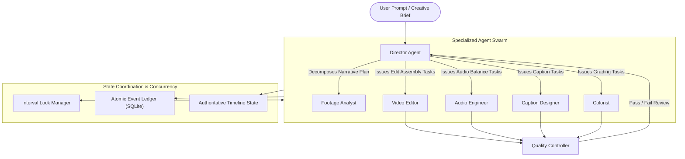

# Specification: Multi-Agent Orchestration & Concurrency Control

## 1. Module Overview

AgentCut enables collaborative production through specialized, autonomous AI agent roles. Rather than relying on a single monolithic prompt that attempts to handle editing, sound design, color grading, and quality control simultaneously, the orchestration layer divides production into discrete, specialized domains.

The orchestration layer coordinates these agents against a **single authoritative project state** with **optimistic concurrency locking** and an **atomic event ledger**.

---

## 2. Agent Role Definitions & Responsibilities



### 2.1 The Seven Specialized Agent Roles

1. **Director Agent (`role: director`, Color: `#E056FD`)**:
   - **Responsibility**: Interprets high-level human prompts (e.g. *"Create a 45s punchy TikTok"*), breaks down the creative brief into a structured narrative edit plan, defines target pacing, and orchestrates task assignments to subagents.
   - **Authority**: High-level task planner, review orchestrator.

2. **Footage Analyst (`role: analyst`, Color: `#F0932B`)**:
   - **Responsibility**: Queries the Video Intelligence Engine. Identifies viral hooks, isolates topic transition boundaries, detects filler stutters, and flags awkward silences vs. dramatic pauses.
   - **Output**: Curated list of suggested clip in/out candidates with thematic ratings.

3. **Video Editor (`role: editor`, Color: `#00D9FF`)**:
   - **Responsibility**: Constructs the primary video tracks (V1, V2). Executes cuts, creates jump cuts with alternating 1.1x punch-ins, trims dead air, and places transitions.
   - **Authority**: Primary video timeline track mutations.

4. **Audio Engineer (`role: audio`, Color: `#686DE0`)**:
   - **Responsibility**: Balances dialog audio, applies loudness normalization (-14 LUFS for web/social), synchronizes background music, and ducks music volume during active speech.
   - **Authority**: Audio timeline track mutations and audio filter configurations.

5. **Caption Designer (`role: captions`, Color: `#F9CA24`)**:
   - **Responsibility**: Generates animated, word-level synchronized subtitle clips. Styles font, size, drop shadows, and active spoken word highlights.
   - **Authority**: Subtitle and text overlay track mutations.

6. **Colorist (`role: colorist`, Color: `#6AB04C`)**:
   - **Responsibility**: Applies cinematic color grading, adjusts saturation, temperature, contrast curves, and corrects shot-to-shot exposure differences.
   - **Authority**: Video filter stack adjustments.

7. **Quality Controller (`role: qc`, Color: `#EB4D4B`)**:
   - **Responsibility**: Runs automated post-edit verification. Detects flash frames (< 2 frames), black gaps, speech clipping, audio distortion, or caption overlap before rendering.
   - **Authority**: Issues approval tokens or triggers revision tasks back to specific agents.

---

## 3. Concurrency Control & State Synchronization

### 3.1 Interval-Based Optimistic Locking
To prevent race conditions when multiple agents work simultaneously:
1. When an agent intends to edit a track (e.g. Video Track 1 between seconds `12.0` and `24.5`), it requests an **Interval Lock**:
   ```python
   lock = lock_manager.acquire(
       track_id="track_v1",
       start_time=12.0,
       end_time=24.5,
       agent_id="video_editor_1",
       timeout_seconds=5.0
   )
   ```
2. If another agent holds an overlapping interval lock on that track, the request is either queued or rejected with a `ResourceLockedException`.
3. Separate tracks (e.g. Video Track 1 vs. Caption Track 3) can be edited concurrently without contention.

### 3.2 Atomic Transactions & Rollback
All multi-step operations (e.g. "replace silence with jump cut") are executed in an atomic transaction:
```python
with timeline.transaction(agent_id="video_editor_1") as txn:
    txn.split_clip(clip_id="c1", split_at=14.2)
    txn.remove_clip(clip_id="c1_silence")
    txn.apply_punch_in(clip_id="c1_b", scale=1.15)
```
If any statement within the block raises an exception (e.g. invalid time range), the transaction automatically aborts and restores the pre-transaction checkpoint.

---

## 4. Operational Provenance & Event Ledger

Every mutation generates a structured provenance record logged to the SQLite table `editing_events`:

```sql
CREATE TABLE editing_events (
    event_id TEXT PRIMARY KEY,
    project_id TEXT NOT NULL,
    agent_id TEXT NOT NULL,
    agent_name TEXT NOT NULL,
    agent_color TEXT NOT NULL,
    action_type TEXT NOT NULL,
    description TEXT NOT NULL,
    target_track INTEGER,
    timeline_position REAL,
    duration REAL,
    source_clip TEXT,
    payload_json TEXT NOT NULL,
    created_at TIMESTAMP DEFAULT CURRENT_TIMESTAMP
);
```

This ledger is the source of truth for both project auditability and the **Cinematic Multi-Agent Replay Engine**.

