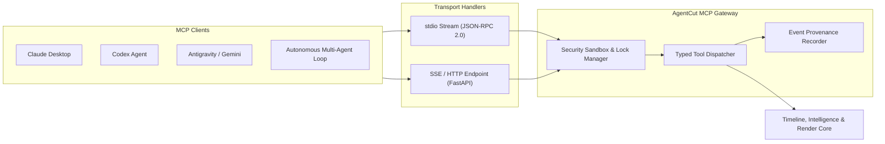

# Specification: Model Context Protocol (MCP) Server

## 1. Module Overview

The **AgentCut MCP Server** exposes the complete video intelligence, timeline manipulation, effects, and rendering capabilities of AgentCut to external AI agents over the open Model Context Protocol (MCP).

The MCP server acts as an intelligent boundary. It abstracts complex non-linear video editing algorithms, MLT XML manipulations, and PyTorch/ONNX models behind strongly typed, validated tool contracts. External agents—whether running inside Claude Desktop, Codex, Antigravity, or custom autonomous loops—can inspect media, make editing decisions, assemble projects, and render broadcasts safely.

---

## 2. Protocol & Transport Architecture

The server implements the Model Context Protocol specification v1.x with dual transports:
1. **Standard I/O (`stdio`)**: The default transport for local CLI agents and Claude Desktop integrations where AgentCut runs as an attached subprocess.
2. **Server-Sent Events (`SSE`)**: Networked HTTP/SSE transport enabling remote agents or distributed multi-agent swarms to communicate over HTTP with real-time push streaming.

---

## 3. Tool Specifications & Schemas

### 3.1 Project & Asset Tools

#### `create_project`
- **Description**: Creates a new AgentCut video editing project workspace.
- **Parameters**:
  - `project_name` (`string`): Human-readable project name.
  - `width` (`integer`, default `1920`): Canvas pixel width.
  - `height` (`integer`, default `1080`): Canvas pixel height (e.g. `1080` for 16:9, `1920` for 9:16 vertical).
  - `fps` (`number`, default `30.0`): Project framerate.
- **Returns**: `{"project_id": "prj_...", "status": "created", "path": "..."}`

#### `open_project`
- **Description**: Loads an existing project into memory for inspection or modification.
- **Parameters**: `project_path` (`string`).
- **Returns**: Project summary and asset list.

#### `save_project`
- **Description**: Atomically commits timeline and project state to SQLite and exports the `.kdenlive` XML document.
- **Parameters**: `project_id` (`string`).
- **Returns**: Confirmation and output file paths.

#### `get_project_timeline`
- **Description**: Retrieves the current multi-track timeline hierarchy, tracks, clips, in/out points, transitions, and filters.
- **Parameters**: `project_id` (`string`).
- **Returns**: Complete JSON representation of tracks and active clips.

#### `import_media`
- **Description**: Ingests a raw media file into the project bin, verifies headers, and extracts initial stream metadata.
- **Parameters**:
  - `project_id` (`string`).
  - `file_path` (`string`): Absolute or sandboxed path to media.
- **Returns**: `{"asset_id": "ast_...", "duration": 120.4, "resolution": "1920x1080", "fps": 30.0}`

---

### 3.2 Video Intelligence Tools

#### `analyze_video`
- **Description**: Triggers the comprehensive multi-stage intelligence pipeline on an ingested media asset.
- **Parameters**:
  - `project_id` (`string`).
  - `asset_id` (`string`).
  - `run_visual_semantics` (`boolean`, default `false`): Whether to load VLM for semantic scene captions.
- **Returns**: `{"status": "completed", "transcribed_words": 842, "scenes_detected": 14, "silences_found": 23}`

#### `get_video_analysis`
- **Description**: Retrieves the complete normalized intelligence graph for a media asset.
- **Parameters**: `project_id` (`string`), `asset_id` (`string`).
- **Returns**: Full unified JSON schema (speech, silences, disfluencies, scenes, keyframes, OCR).

#### `get_transcript`
- **Description**: Returns formatted dialogue with word-level timestamps and speaker attributions.
- **Parameters**:
  - `project_id` (`string`), `asset_id` (`string`).
  - `speaker_filter` (`string`, optional): Only return dialogue for a specific speaker.
- **Returns**: Array of timestamped sentence and word objects.

#### `get_silence_segments`
- **Description**: Retrieves non-speech segments categorized into conversational, dramatic, or dead silence.
- **Parameters**:
  - `project_id` (`string`), `asset_id` (`string`).
  - `min_duration` (`number`, default `0.5`): Minimum silence duration in seconds.
  - `category` (`string`, optional): Filter by `dead_silence`, `dramatic_pause`, etc.
- **Returns**: Array of silence intervals with recommended editing actions.

#### `get_detected_text`
- **Description**: Returns on-screen text recognized via OCR, including temporal appearance windows and bounding boxes.
- **Parameters**: `project_id` (`string`), `asset_id` (`string`).
- **Returns**: Deduplicated text appearances with `start_time` and `end_time`.

#### `search_video_content`
- **Description**: Semantic and keyword search across transcripts, detected text, and visual descriptions.
- **Parameters**: `project_id` (`string`), `query` (`string`).
- **Returns**: Ranked search matches with exact seek timestamps.

---

### 3.3 Timeline & Editing Tools

#### `add_video_clip`
- **Description**: Places a segment of source footage onto a video timeline track.
- **Parameters**:
  - `project_id` (`string`).
  - `track_index` (`integer`): Target video track (1 for V1, 2 for V2).
  - `asset_id` (`string`).
  - `timeline_in` (`number`): Starting position on the master timeline in seconds.
  - `source_in` (`number`): In-point on source footage in seconds.
  - `source_out` (`number`): Out-point on source footage in seconds.
- **Returns**: `{"clip_id": "clp_...", "duration": 5.2}`

#### `split_clip`
- **Description**: Slices an existing clip at a specific timeline timestamp into two independent clips.
- **Parameters**:
  - `project_id` (`string`), `clip_id` (`string`).
  - `split_time` (`number`): Timeline cut timestamp.
- **Returns**: `{"left_clip_id": "clp_1a", "right_clip_id": "clp_1b"}`

#### `trim_clip`
- **Description**: Adjusts the in-point or out-point of an existing clip on the timeline.
- **Parameters**:
  - `project_id` (`string`), `clip_id` (`string`).
  - `delta_in` (`number`, default `0.0`): Seconds to adjust start (+ expands, - trims).
  - `delta_out` (`number`, default `0.0`): Seconds to adjust end.
- **Returns**: Updated clip bounds.

#### `move_clip`
- **Description**: Repositions a clip to a new timeline timestamp and/or moves it to another track.
- **Parameters**:
  - `project_id` (`string`), `clip_id` (`string`).
  - `new_timeline_in` (`number`).
  - `new_track_index` (`integer`, optional).
- **Returns**: Updated placement confirmation.

#### `set_clip_speed`
- **Description**: Adjusts playback speed (e.g. 0.5x slow-mo, 1.25x fast-pace) with audio pitch correction.
- **Parameters**: `project_id` (`string`), `clip_id` (`string`), `speed` (`number`).

---

### 3.4 Effects & Captions Tools

#### `add_transition`
- **Description**: Creates a transition (crossfade, wipe, dip-to-black) between two adjacent clips.
- **Parameters**:
  - `project_id` (`string`).
  - `transition_type` (`string`): `crossfade`, `wipe`, `luma_wipe`.
  - `track_from` (`integer`), `track_to` (`integer`).
  - `start_time` (`number`), `duration` (`number`).

#### `adjust_color`
- **Description**: Applies color grading adjustments (lift, gamma, gain, saturation, temperature).
- **Parameters**:
  - `project_id` (`string`), `clip_id` (`string`).
  - `saturation` (`number`, default `1.0`), `contrast` (`number`, default `1.0`), `temperature` (`number`, default `0.0`).

#### `generate_captions`
- **Description**: Generates synchronized animated subtitle clips from dialogue timestamps.
- **Parameters**:
  - `project_id` (`string`).
  - `target_track` (`integer`, default `3`): Subtitle track.
  - `style` (`object`): Font, size, color, background, active-word highlight color.
  - `max_words_per_line` (`integer`, default `4`).

---

### 3.5 Rendering & Export Tools

#### `render_video`
- **Description**: Renders the timeline into a production MP4 file.
- **Parameters**:
  - `project_id` (`string`).
  - `preset` (`string`): e.g. `tiktok_9_16_1080p`, `youtube_16_9_4k`, `preview_720p`.
  - `output_filename` (`string`, optional).
- **Returns**: `{"job_id": "rnd_...", "status": "started"}`

#### `get_render_status`
- **Description**: Queries real-time render progress percentage, elapsed time, and output path.
- **Parameters**: `job_id` (`string`).
- **Returns**: `{"progress": 68.5, "status": "rendering", "eta_seconds": 12.0}`

---

### 3.6 Collaboration & Concurrency Tools

#### `register_agent`
- **Description**: Registers an active AI agent with its role, display name, and cursor color.
- **Parameters**:
  - `project_id` (`string`).
  - `agent_id` (`string`): e.g. `video_editor_1`.
  - `agent_role` (`string`): `director`, `analyst`, `editor`, `audio`, `captions`, `colorist`, `qc`.
  - `agent_name` (`string`): e.g. `"Video Editor"`.
  - `color_hex` (`string`): e.g. `"#00D9FF"`.
- **Returns**: `{"token": "tok_...", "status": "registered"}`

#### `publish_editing_event`
- **Description**: Records an action event into the authoritative SQLite ledger for the Cinematic Replay engine.
- **Parameters**: Event metadata payload (`agent_id`, `action`, `track`, `position`, `description`).

#### `create_checkpoint` / `undo_last_operation`
- **Description**: Creates or rolls back to a named snapshot of the project timeline.

