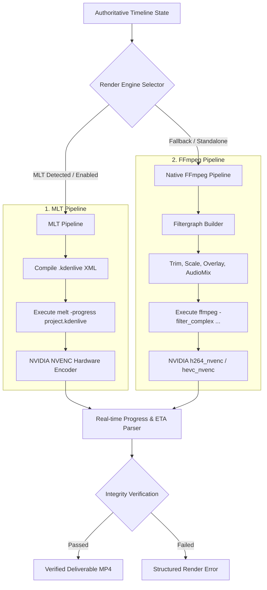

# Specification: Dual-Engine Rendering & Export Pipeline

## 1. Module Overview

The **Rendering & Export Engine** converts the abstract multi-track timeline into broadcast-grade video deliverables. To guarantee operational success regardless of the host environment, AgentCut implements a **Dual-Engine Architecture**:
1. **MLT `melt` Engine**: Direct headless rendering of native `.kdenlive` project files.
2. **Native FFmpeg Fallback Engine**: Generates and executes a dynamic multi-input filtergraph (`-filter_complex`), providing high-speed out-of-the-box rendering even if MLT is not yet installed.

---

## 2. Rendering Pipelines

---

## 3. Aspect Ratio Presets & Framing Transformations

AgentCut supports standard broadcast and social video formats:

| Preset Name | Resolution | Aspect Ratio | Target Platform | Framing Strategy |
| :--- | :--- | :--- | :--- | :--- |
| `tiktok_reels_9_16` | 1080 x 1920 | 9:16 Vertical | TikTok, IG Reels, YT Shorts | Smart Center-Crop or Blurred Pillar Background |
| `youtube_16_9_1080p` | 1920 x 1080 | 16:9 Landscape | YouTube, Web, Television | Direct 1:1 Pixel Mapping |
| `youtube_16_9_4k` | 3840 x 2160 | 16:9 Ultra HD | Premium YouTube / Archive | 4K Master Render (NVENC) |
| `square_1_1` | 1080 x 1080 | 1:1 Square | Instagram Feed, LinkedIn | Center Crop with Subtitle Padding |

---

## 4. Hardware Encoding Optimization (RTX 4050 NVENC)

When available, hardware-accelerated video encoding is prioritized:
- **Video Codec**: `h264_nvenc` (or `hevc_nvenc` for 4K).
- **Preset**: `p4` (balanced speed/quality) or `p6` (high quality).
- **Rate Control**: Constrained Baseline / CQ 20 (`-rc:v vbr -cq:v 20`).
- **Audio Codec**: `aac` at 192 kbps, 48000 Hz stereo.
- **CPU Fallback**: If NVENC encounters driver limitations, the engine falls back to `libx264` (`-preset veryfast -crf 20`).

---

## 5. Render Monitoring & Verification Gate

### 5.1 Real-Time Progress Tracking
The engine attaches to stdout/stderr of the renderer subprocess:
- MLT `melt`: Parses `Current Frame: 450, percentage: 35%`.
- FFmpeg: Parses `frame= 450 fps= 124 q=24.0 size= 4520kB time=00:00:15.00 bitrate= 2468.0kbits/s`.
- Dispatches WebSocket events to the UI: `{"job_id": "...", "progress_pct": 35.0, "fps": 124, "eta_s": 8.4}`.

### 5.2 Graceful Cancellation
If the user or agent issues a cancel command, the engine sends `SIGTERM` / `Ctrl+Break` on Windows, allows 1.5 seconds for graceful file finalization, and unlinks temporary output artifacts.

### 5.3 Post-Render Integrity Verification
Before returning a successful status, the deliverable must pass three checks:
1. **Non-Zero File Size**: File exists on disk and is $> 100 \text{ KB}$.
2. **Container Header Validation**: `ffprobe` successfully parses video and audio streams without demuxing errors.
3. **Duration Concordance**: Rendered file duration matches the timeline length within $\pm 0.2 \text{ seconds}$.

