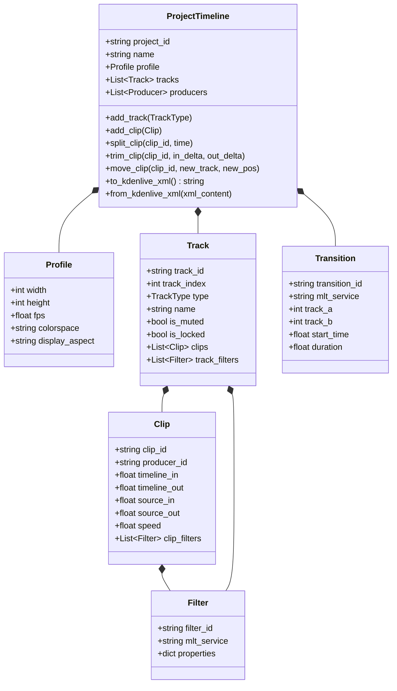

# Specification: Timeline Engine & Kdenlive XML Integration

## 1. Module Overview

The **Timeline Engine** is the deterministic core of AgentCut. It maintains an in-memory, object-oriented representation of the multi-track editing project, handles non-destructive editing operations, enforces temporal validity rules, and serializes seamlessly to and from the official **Kdenlive / MLT XML project format (`.kdenlive`)**.

---

## 2. Abstract Timeline Data Model

---

## 3. Kdenlive / MLT XML Format Specification

The generated `.kdenlive` file adheres strictly to the official MLT XML and Kdenlive 23.x/24.x document standards:

1. **Root `<mlt>` Element**:
   - `LC_NUMERIC="C"`, `version="7.x"`.
2. **Global `<profile>` Element**:
   - Defines standard profile properties: `width="1920"`, `height="1080"`, `frame_rate_num="30000"`, `frame_rate_den="1001"`, `sample_aspect_num="1"`, `sample_aspect_den="1"`, `display_aspect_num="16"`, `display_aspect_den="9"`.
3. **Producers (`<producer>`)**:
   - Each unique raw video, audio, or title asset is defined as an MLT `<producer>` with a unique ID (`producer0`, `producer1`).
   - Custom Kdenlive properties are preserved via the `kdenlive:` namespace (`kdenlive:clipname`, `kdenlive:folderid`, `kdenlive:originalurl`).
4. **Playlists (`<playlist>`)**:
   - Each track corresponds to a primary `<playlist id="playlist#">`.
   - Sequential clips are defined via `<entry producer="producer#" in="start_frame" out="end_frame"/>`.
   - Temporal gaps between clips are represented by `<blank length="gap_frames"/>`.
5. **Main Tractor (`<tractor id="maintractor">`)**:
   - Assembles the individual track playlists (`<track producer="playlist0"/>`, `<track producer="playlist1"/>`).
   - Hosts multi-track compositing transitions (`<transition id="transition0"> <property name="mlt_service">frei0r.cairoblend</property> </transition>`).
   - Hosts master audio mixing filters (`volume`, `loudness`).

---

## 4. Editing Operations & Algorithms

### 4.1 Non-Destructive Clip In/Out Mathematics
Given a clip $C$ placed on the timeline at time $T_{in}$ with duration $D$:
- Master Timeline span: $[T_{in}, T_{in} + D]$
- Source Media span: $[S_{in}, S_{in} + D]$
- Frame conversion: $F = \text{round}(T \times \text{fps})$

### 4.2 Split Clip (Razor Blade) Algorithm
To split clip $C$ at master timeline position $T_{split}$ where $T_{in} < T_{split} < T_{in} + D$:
1. Calculate delta: $\Delta = T_{split} - T_{in}$.
2. Clip $C_1$ (Left):
   - $T_{in}^{(1)} = T_{in}$, $T_{out}^{(1)} = T_{split}$
   - $S_{in}^{(1)} = S_{in}$, $S_{out}^{(1)} = S_{in} + \Delta$
3. Clip $C_2$ (Right):
   - $T_{in}^{(2)} = T_{split}$, $T_{out}^{(2)} = T_{in} + D$
   - $S_{in}^{(2)} = S_{in} + \Delta$, $S_{out}^{(2)} = S_{out}$
4. Replace $C$ with $C_1$ and $C_2$ in the track's ordered clip sequence.

### 4.3 Dynamic Jump Cut with Punch-In Keyframing
When removing pauses between two speech segments $A$ and $B$:
1. Segment $A$ remains at normal scale ($1.0\times$).
2. Segment $B$ is assigned an affine transform filter (`qtblend` or `frei0r.scale`):
   - Center crop: Scale factor $1.15\times$, anchor $(0.5, 0.5)$.
   - Creates the professional visual illusion of a secondary camera angle, eliminating the jarring jerkiness of raw jump cuts.

### 4.4 Synchronized Animated Caption Generation
1. Consumes word tokens with exact start/end times from the Video Intelligence Engine.
2. Formats phrases into 2-4 word readable clusters.
3. Generates title clips with styling:
   - Primary text: White font, black stroke outline, drop shadow.
   - Active word: Dynamically highlighted in high-contrast yellow (`#FFDE00`) or cyan (`#00D9FF`) during its active audio interval.

